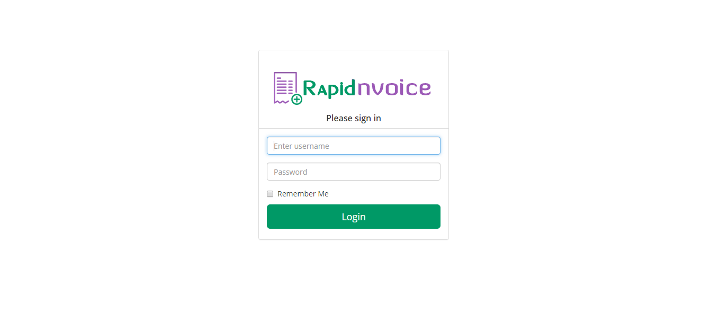
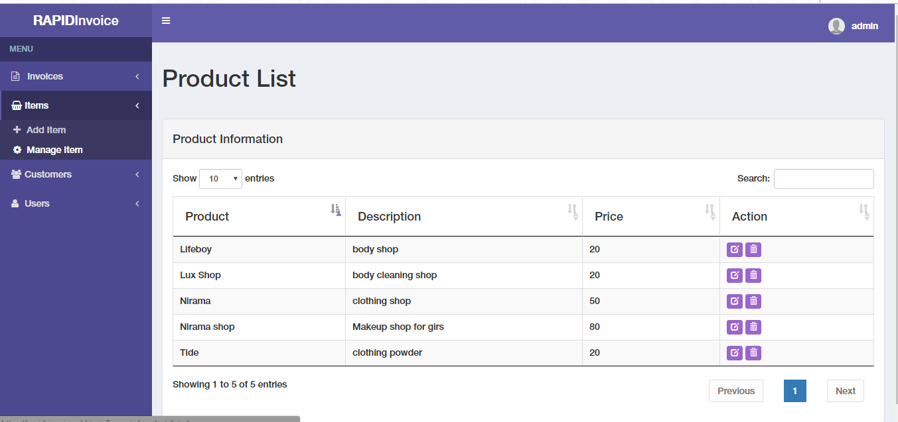
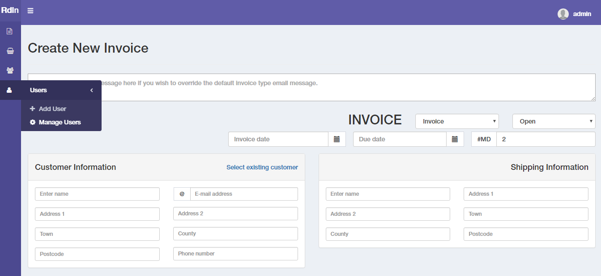

# Sistema Rápido de Gestión de Facturas

El sistema Rapid Invoice Management es una solución de facturación / cobro basada en la nube y de rápida ejecución. El sistema le permite agregar productos y artículos, crear clientes y usuarios, y generar tantas facturas, recibos y cotizaciones como desee.

El sistema ofrece otras características impresionantes, que incluyen cálculos instantáneos de facturas para artículos, cantidad, descuentos, impuestos / IVA y total, sin esfuerzo adicional. Creé esta aplicación para experimentar con PHP, MYSQL, JQuery y para implementar la funcionalidad de la plantilla de administración de boostrap en el proyecto.

<h2>Capturas de pantalla</h2>

<h2>Características</h2>

<ul>
<li>Diseño adaptable (responsive), fácilmente accesible en diferentes dispositivos.</li>
<li>Generar facturas y recibos</li>
<li>Números de factura únicos</li>
<li>Funcionalidad para crear un artículo de factura cada vez o elegir desde la base de datos.</li>
<li>Funcionalidad para agregar y eliminar IMPUESTOS.</li>
<li>		Ingresar los datos de envío manualmente o seleccionar desde la base de datos al crear la factura</li>
<li>		Enviar recibos a la dirección de correo electrónico del cliente</li>
<li>		Generar archivos PDF y Excel descargables</li>
<li>	Gestión de usuarios: crear usuarios para iniciar sesión y utilizar el sistema</li>
<li> Y mucho más...</li>
</ul>

<h2>Tecnología, Herramientas y Complementos Utilizados</h2>

<ul>
<li>PHP y MySql</li>
<li>Boostrap</li>
<li>JQuery</li>
<li>PHPMailer</li>
<li>TimePicker</li>
<li>ColorPicker</li>
<li>fpdf: Para generar archivos PDF</li>
</ul>

<h2>Requisitos para ejecutar el proyecto</h2>
<ul>
<li>PHP 5.0+</li>
<li>Base de datos MYSQL</li>
</ul>

<h2>Configuración</h2>

<ul>
<li>Clonar el repositorio en su sistema</li>
<li>Subir todos los archivos a su servicio de alojamiento web a través de FTP o en su administrador de archivos en línea</li>
<li>Cambiar los permisos de la carpeta a 0777</li>
<li>Configurar / Crear su base de datos, usuario y contraseña en mysql / phpmyadmin o en el panel de control de su alojamiento</li>
<li>Importar el archivo setup.sql desde la carpeta a la base de datos</li>
<li>Abrir "includes/config.php" y configurar el archivo con los datos de la base de datos</li>
<li>Ingresar los detalles de inicio de sesión predeterminados, nombre de usuario: admin - contraseña: admin</li>
<li>Eso es todo. Disfrute del sistema de forma gratuita.</li>
</ul>

<h2>Créditos</h2>
<li>http://www.fpdf.org/</li>
<li>https://almsaeedstudio.com/</li>

<h2>Nota</h2>
Este sistema de facturación puede utilizarse para cualquier tipo de facturación, desde la facturación interna general, el comercio electrónico, hasta la facturación de productos y servicios. Sin embargo, el sistema puede contener errores. No dude en reportarlos. Además, bifurque (fork) el repositorio para experimentar y agregar más funcionalidades.
